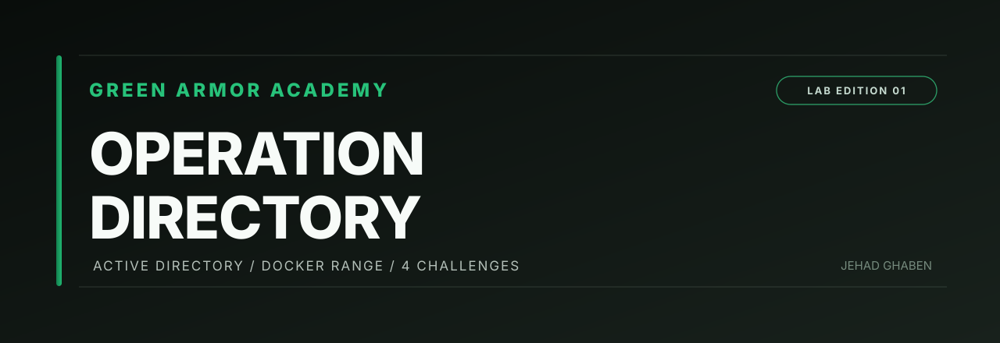

<div align="center">



# GREEN ARMOR AD RANGE
### Operation Directory — lightweight, isolated Active Directory training

**Created by JEHAD GHABEN · GREEN ARMOR ACADEMY**

**Samba AD · LDAP · Kerberos · SMB · Docker Compose · 4 rotating flags**

[الدليل العربي](README_AR.md) · [Student task](docs/STUDENT_TASK.md) · [Architecture](docs/ARCHITECTURE.md) · [Troubleshooting](docs/TROUBLESHOOTING.md)

</div>

---

## Purpose

A **single-domain-controller Active Directory learning range** using Samba (not Windows Server). Students work from a second container and follow four connected tasks covering SMB discovery, LDAP enumeration, exposed service credentials, and excessive archive access.

**Important:** This is a deliberately vulnerable **training environment**, not a real Microsoft Windows AD domain. There are no Windows workstations, GPO attack scenarios, AD CS, or domain trusts.

## Requirements

- Linux with **Docker Engine and Docker Compose v2** (recommended). Docker is not bundled.
- Python 3.9 or later; an internet connection to build the containers initially.
- Approximately **2 GB RAM free** and **3 GB disk space** are reasonable starting estimates, not measured minimums.
- On Parrot OS: if `docker` displays *“Emulate Docker CLI using podman”*, you are using a **Podman compatibility wrapper**. The lab's target runtime is real Docker Engine. Podman may require separate configuration and is not guaranteed to behave identically.

## Get started

After publishing this package in a new **public** repository named `green-armor-ad-range` under your account, students can run:

```bash
# Repository must be created and uploaded first.
git clone https://github.com/JehadGhaben/green-armor-ad-range.git
cd green-armor-ad-range
python3 armorlab.py doctor
python3 armorlab.py up
python3 scripts/smoke-test.py
python3 armorlab.py info
python3 armorlab.py shell
```

For a downloaded ZIP, extract it, then `cd green-armor-ad-range` and use the same commands after `git clone`.

`doctor` checks the container CLI. `up` builds and starts **one Samba AD DC and one student toolbox**. `smoke-test.py` checks real SMB, LDAP, the four flags, and access controls. Do not hand out the task until the smoke test passes.

The environment is **internal-only** (no published ports). Students work inside the bundled student container, not by connecting directly from the host.

### Initial account

| Setting | Value |
| --- | --- |
| Domain | `ARMOR.TEST` |
| NetBIOS | `ARMOR` |
| Domain Controller | `dc` |
| Username | `student01` |
| Password | `GreenArmor2026!` |

From within the student toolbox:

```bash
dig @dc _ldap._tcp.armor.test SRV
smbclient -L //dc -U 'ARMOR\student01'
ldapsearch -x -H ldap://dc -D 'student01@armor.test' -W \
  -b 'DC=armor,DC=test' '(objectClass=user)' sAMAccountName description
```

## University assessment

| Flag | Topic | Points |
| --- | --- | ---: |
| 01 | Network and SMB discovery | 15 |
| 02 | LDAP directory enumeration | 20 |
| 03 | Exposed service-account credentials | 25 |
| 04 | Restricted archive access via exposed identity | 40 |
| **Total** | | **100** |

Flags follow the pattern `GA{01-RANDOMHEX}` and change with each **reset**. The scorer is **local self-assessment**, not a tamper-proof grading server. Students control their own lab host, so instructors should grade accompanying reports and evidence, not trust the score file alone.

### Management commands (run on the Linux host)

```bash
python3 armorlab.py info
python3 armorlab.py hint 02 1
python3 armorlab.py submit 'GA{...}'
python3 armorlab.py score
python3 armorlab.py status
python3 armorlab.py logs
python3 armorlab.py down
python3 armorlab.py reset --yes  # Permanently deletes local lab data and progress
```

## Verified checks and GitHub CI

The repository includes:

- Python unit tests, Bash syntax checking, and a Docker dependency regression test.
- A **real Docker smoke job** in `.github/workflows/ci.yml`. Once uploaded, GitHub Actions attempts a full Samba deployment and verifies all four flags and SMB/LDAP access behavior. Check **Actions → Build, test and run the AD range**; only a green `real-docker-smoke` job confirms the build worked on its Linux runner.
- A local `python3 scripts/smoke-test.py` for your own Linux host.

**Release verification status:** static checks run during package preparation; the actual Samba/Docker containers could **not** be executed in the artifact-building environment. You must check the GitHub Actions run and preferably the smoke test on Parrot/Kali before teaching with it. A green GitHub run does not guarantee every host or Podman setup works.

## Distribution, limits and safety

- Publish **project files**, not the ZIP as a single item, so `git clone` works normally.
- `runtime/` is ignored by Git and contains per-installation secrets. Do not commit it or any instructor-only solution sheet.
- No ports are published, and both containers attach only to one internal Docker bridge. Never connect the intentionally weak lab network to a real domain, campus infrastructure, or the Internet.
- This lab is not suitable for high-stakes anti-cheating assessments on student-controlled machines.
- No Microsoft endorsement is implied; this is an educational Samba AD simulation.

**Author:** JEHAD GHABEN  
**Organization:** GREEN ARMOR ACADEMY  
**Website:** https://www.greenarmor.academy  
**License:** MIT (see `LICENSE`)
